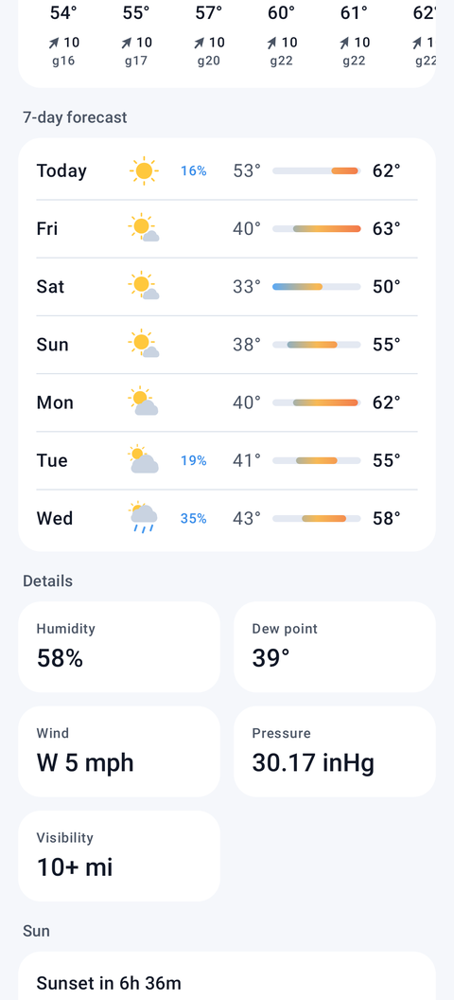
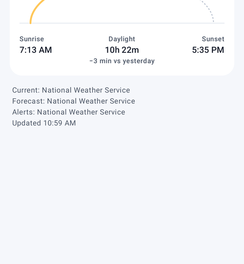

# Northvane

[](https://github.com/603Madison/Northvane-Weather/actions/workflows/ci.yml)

A clean, private weather app for Android.

Northvane shows current conditions, hourly and 10-day forecasts, animated radar
with a future cast, and National Weather Service alerts. It uses free NOAA/NWS
data, can take current conditions from **your own WeeWX station**, and keeps
working over **satellite links such as T-Mobile T-Satellite**. No API key is
built into the app, and there are no accounts, ads or analytics.

| | |
|---|---|
| **Forecast numbers** | Hourly and daily wind, gusts, rain/snow/ice amounts, humidity, cloud cover, thunder chance (NWS gridpoint data) |
| **Power outage outlook** | Optional daily estimate tuned for New England (gusts + leaf-on season, ice, wet snow, saturated ground, alerts) |
| **Current conditions** | Your WeeWX station → nearest NWS observation → OpenWeatherMap (optional) → NWS hourly estimate |
| **Hourly / daily forecast** | NWS (api.weather.gov) → OpenWeatherMap (optional, e.g. outside the US) |
| **Alerts & notifications** | NWS active alerts for every saved location, checked in the background |
| **Radar** | NOAA MRMS (official) or NEXRAD composite, plus NOAA HRRR model future cast |
| **Satellite** | Opts in to Android 16 constrained satellite networks; automatic data-saver mode |
| **Look & feel** | Material 3, light/dark/system theme, optional wallpaper colors, °F/°C |

<p>




</p>
<p>



</p>

*Screenshots are rendered from real NWS responses for Portland, ME by `ScreenshotTest` (the outage example adds a synthetic nor'easter day).*

## Install

Download the latest APK from [Releases](https://github.com/603Madison/Northvane-Weather/releases),
check it against `SHA256SUMS.txt`, and open it on your phone (you'll be asked to
allow installs from your browser or file manager). Northvane runs on Android 8.0+.
The satellite features need Android 16+ and a carrier that supports satellite data.

## Status

Version 1.0.0. The data layer is tested against captured and live NWS, NOAA and
IEM responses, and every screen is rendered in tests. Still to be exercised on
real hardware: the radar map, notifications, connecting to a WeeWX station on a
LAN, and behavior on an actual satellite connection. Bug reports from those
setups are especially welcome. See [CONTRIBUTING.md](CONTRIBUTING.md).

## Features

### Weather data
- **NWS first, for free.** Grid metadata for each location is cached for two
  weeks, so a refresh is a handful of small, gzip-compressed requests.
- **WeeWX override.** Link a station to a saved location and its readings
  (temperature, humidity, wind, pressure, rain, UV, solar) replace the NWS
  observation. Sky condition and visibility are filled from NWS. Stale station
  data falls back to NWS automatically. See [`weewx/README.md`](weewx/README.md).
- **OpenWeatherMap only as a last resort**, off by default, using *your* key
  entered in the app. It's used only when NWS/WeeWX can't supply a section,
  such as for locations outside the US.
- Offline-friendly: the last result per location is cached on the device.

### Forecast details
- Real numbers, not just the forecast wording. The NWS **gridpoint forecast**
  (~10 KB compressed) adds gusts, wind direction, rain/snow/ice amounts, sky
  cover, humidity, feels-like temperature and thunder probability to every
  hour and day.
- **Hourly** view: switch between precipitation (chance and amount), wind
  (direction arrow, speed, gusts), humidity/dew point, feels-like and clouds.
- **Daily** view: tap a day for its wind and gusts, totals, humidity range,
  cloud cover, thunder chance and the outage outlook. If detailed data is turned
  off for satellite, amounts are read from the NWS forecast text instead.
- **Sun** card: the sun's path across the sky with its current position, time
  to sunset or sunrise, day length and the change since yesterday.

### Power outage outlook (optional)
A rough, transparent daily score (Low / Elevated / High / Very high) built for
New England's tree-lined overhead lines. Each day lists the factors behind it:

- **Gusts**, weighted up while trees are in leaf (mid-May to early November),
  when the same wind brings down far more limbs.
- **Ice** from freezing rain, roughly following the Sperry-Piltz ice index
  (0.25" scattered outages, 0.5"+ widespread), worse with wind.
- **Heavy wet snow** near freezing or with a low snow-to-liquid ratio, and
  especially early or late-season snow on leafed trees (October 2011, October 2020).
- **Saturated ground** (1"+ of rain) combined with wind, **thunderstorms**, heat,
  and active **NWS alerts** (High Wind, Ice Storm, Winter Storm, and others).

This is not a utility forecast. Turn it on or off in Settings › Forecast.

### Alerts
- Background checks every 15/30/60 minutes (WorkManager) for all saved locations.
- **Send test notification** in Settings shows exactly how a warning will look and sound.
- Separate notification channels for **Warnings** (high priority), **Watches**,
  **Advisories** and **Statements**, each opt-in.
- Updates to an alert replace its earlier notification instead of stacking.
  Notifications expire when the alert ends, and tapping one opens the Alerts tab.

### Radar
- Past hour from **NOAA MRMS** via the NWS time-enabled image service (default),
  or the **IEM NEXRAD composite** as an alternative. Frames follow the actual
  scan times in NOAA's image catalog, and each frame draws the newest scan for
  every region (CONUS, Alaska, Hawaii, Puerto Rico, Guam).
- **Future cast**: up to 3 hours of HRRR simulated reflectivity (NOAA's
  rapid-refresh model, served as map tiles by the Iowa Environmental Mesonet).
- Keyless OpenStreetMap basemap (OpenFreeMap) via MapLibre, with light and
  dark styles.

### Satellite connectivity (T-Satellite and similar)
- The manifest declares
  `android.telephony.PROPERTY_SATELLITE_DATA_OPTIMIZED`, so on Android 16+ the
  app is allowed onto constrained satellite networks and is listed among
  satellite-enabled apps in system Settings.
- `ConnectivityMonitor` follows Google's guidance: it requests a network
  *without* `NET_CAPABILITY_NOT_BANDWIDTH_CONSTRAINED` and treats it as
  constrained if that capability is missing or the transport is
  `TRANSPORT_SATELLITE`.
- **You choose what goes over satellite** (Settings › Satellite & data saver),
  with typical sizes shown for each item: alerts, background alert checks,
  current conditions, WeeWX station (internet-reachable), daily forecast,
  forecast details, hourly forecast, radar, radar future cast and the
  OpenWeatherMap fallback. Limits apply on satellite automatically, always, or
  never.
- Anything turned off keeps showing its last downloaded data (expired alerts
  are dropped), and the Today screen lists what's paused. Timeouts are generous
  for high-latency links.

## Building

Requirements: a current Android Studio (with AGP 9.4 support), JDK 17+ and the
Android SDK platform 37 (Android 17). The app targets API 37 and runs on Android 8.0+.

```bash
./gradlew :core:test                        # parsers (incl. captured live NWS responses), fallback logic, security policy
./gradlew :core:test -Pnorthvane.live=true    # also hit the real NWS/NOAA/IEM services end to end
./gradlew :app:testDebugUnitTest            # renders screens to app/build/outputs/screenshots (Robolectric)
./gradlew :app:lintDebug                    # Android lint
./gradlew :app:assembleDebug                # installable debug APK in app/build/outputs/apk/debug/
```

Release builds are minified with R8. To sign one, create a git-ignored
`keystore.properties` next to `settings.gradle.kts`:

```properties
storeFile=/path/to/release.jks
storePassword=…
keyAlias=…
keyPassword=…
```

then run `./gradlew :app:assembleRelease`.

The Gradle wrapper uses Gradle 9.6.0 and verifies the distribution's SHA-256
checksum before running it.

## Project layout

```
core/   Pure Kotlin/JVM: API clients (NWS, WeeWX, OpenWeatherMap), parsers,
        source fallback/merge (WeatherRepository), alert tracking, radar
        frame math, unit formatting, URL/cleartext security policy. Unit tested.
app/    Android: Compose UI, MapLibre radar, WorkManager alert checks,
        Keystore-encrypted secret store, DataStore settings, satellite
        connectivity monitor.
weewx/  WeeWX skin + setup guide for the local-station feed.
docs/   Security and privacy notes.
```

## Configuration in the app

- **Settings › Data sources**
  - *NWS contact email* (optional). It goes in the User-Agent sent to
    weather.gov only, as NWS requests.
  - *WeeWX stations*: URL, format, optional login (Basic, bearer token or
    custom header), linked location, and max data age. Includes a
    **Test connection** button. On Android 17+, a station on your home
    network needs the **Nearby devices** permission. The app asks for it
    when you test or save such a station, and only then.
  - *OpenWeatherMap*: enable/disable and enter your API key. The key is stored
    encrypted and never shown again.
- **Settings › Severe weather alerts**: categories, check frequency, channels.
- **Settings › Satellite & data saver**: when limits apply, and a checkbox per data type.
- **Settings › Forecast**: power outage outlook on/off.
- **Settings › Radar**: past-radar source, future cast on/off and range.
- **Settings › Appearance**: System / Light / Dark, wallpaper colors, units.

## Data sources and attribution

- Weather, alerts and radar: NOAA / National Weather Service (public domain).
- HRRR future-cast tiles and the alternative NEXRAD composite: Iowa
  Environmental Mesonet, Iowa State University.
- Basemap: OpenFreeMap; © OpenMapTiles; © OpenStreetMap contributors.
- Optional: OpenWeatherMap (your own account and key).

See [`docs/SECURITY.md`](docs/SECURITY.md) for the security and privacy design, [`SECURITY.md`](SECURITY.md) for reporting vulnerabilities, [`CHANGELOG.md`](CHANGELOG.md) for release notes and [`docs/RELEASING.md`](docs/RELEASING.md) for how releases are made.
